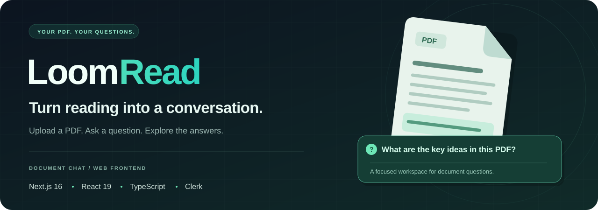

<p align="center">
  
</p>

<p align="center">
  <strong>A focused web interface for conversations with your PDFs.</strong><br />
  Upload a document, follow its processing status, and ask questions in a dedicated chat workspace.
</p>

<p align="center">
  <a href="https://app-liart-psi.vercel.app"><strong>Explore LoomRead ↗</strong></a>
  &nbsp; · &nbsp;
  <a href="#features">Features</a>
  &nbsp; · &nbsp;
  <a href="#getting-started">Getting started</a>
  &nbsp; · &nbsp;
  <a href="#backend-integration">Backend integration</a>
</p>

<p align="center">
  
  
  
  
  
</p>

---

## Meet LoomRead

LoomRead is the web frontend for an AI-assisted PDF question-and-answer application. It brings document uploads, processing feedback, document chat, and account navigation into a dark workspace with emerald accents.

**This repository contains the frontend.** Document storage, PDF processing, retrieval, and answer generation require a separate compatible backend configured through `NEXT_PUBLIC_API_URL`. Those services and model implementations are not included here.

## Features

| From document to question | Around the workspace |
| :--- | :--- |
| **PDF upload** — Select a PDF with client-side file-type and 10 MB size checks. | **Guest sessions** — Upload and chat requests can carry a browser session identifier. |
| **Processing feedback** — Follow processing, ready, and failed document states. | **Clerk accounts** — Signed-in requests use a JWT from the `pdfs` template. |
| **Document chat** — Ask questions after a document is ready and view returned answers. | **Document dashboard** — Browse stored documents, page counts, and status indicators. |
| **Citation display** — Show citation labels returned alongside answers. | **Account screens** — Pricing, billing, account, and team settings interfaces. |

### The intended flow

1. **Choose a PDF** on the upload page.
2. **Send it to the backend** and wait for its processing status.
3. **Open document chat** when the document is ready.
4. **Ask questions** and read the answer and citation labels returned by the backend.

## Tech stack

| Layer | Technologies |
| :--- | :--- |
| Application | Next.js 16 App Router · React 19 · TypeScript |
| Interface | Tailwind CSS 4 · Font Awesome · Geist fonts |
| Authentication | Clerk |
| API integration | Browser Fetch API · Multipart uploads · JSON requests |
| Session state | React hooks · Browser session storage |

## Getting started

You will need Node.js compatible with the pinned Next.js version, npm, your own Clerk application, and a running compatible backend.

### 1. Install

```bash
git clone https://github.com/aeubs66/app.git
cd app
npm ci
```

### 2. Configure the frontend

Copy [`.env.example`](.env.example) to `.env.local` and replace the placeholders.

**PowerShell**

```powershell
Copy-Item .env.example .env.local
```

**macOS / Linux**

```bash
cp .env.example .env.local
```

The core frontend settings are:

| Variable | Purpose |
| :--- | :--- |
| `NEXT_PUBLIC_CLERK_PUBLISHABLE_KEY` | Clerk browser authentication |
| `CLERK_SECRET_KEY` | Server-side Clerk calls, including the billing session route |
| `NEXT_PUBLIC_API_URL` | Base URL of the separate document backend; defaults to `http://localhost:8000` |

For signed-in document requests, configure a Clerk JWT template named **`pdfs`** and configure the backend to validate those tokens. Guest requests send an **`X-Guest-Session`** header instead.

The environment example also retains optional billing and Supabase placeholders from the existing setup. The checked-in frontend does not include a Supabase client.

### 3. Start

```bash
npm run dev
```

Open [localhost:3000](http://localhost:3000). Run your compatible backend separately and configure it to accept requests from the frontend origin.

## Backend integration

The following contracts are derived from the frontend's upload, dashboard, and chat requests:

| Request | Expected behavior |
| :--- | :--- |
| `POST /api/documents/upload` | Accept multipart field `file`; return JSON with `document_id` |
| `GET /api/documents/` | Return a `documents` array for the dashboard |
| `GET /api/documents/{id}` | Return document metadata, including `title` and `status` |
| `POST /api/documents/{id}/ask` | Accept `{ question, k: 5 }`; return `answer` and optional `citations` |

Document states used by the interface are `processing`, `ready`, and `failed`. The upload flow recognizes HTTP `202` as processing still in progress. Account and team screens make additional API calls; consult their source when connecting those features.

<details>
<summary><strong>Current implementation notes</strong></summary>

- Citation buttons display labels, but PDF page navigation is still a TODO.
- The dashboard currently selects the `free` plan in source. Displayed usage limits are not proof of backend enforcement.
- The team invitation interface labels its invitation flow as a placeholder.
- Billing and sign-in routes depend on your Clerk configuration; dedicated `/sign-in` and `/sign-up` page files are not included.
- The backend and deployed service behavior were not exercised during this repository documentation update.

</details>

## Useful commands

| Command | Purpose |
| :--- | :--- |
| `npm run dev` | Start the development server |
| `npm run build` | Create a production build |
| `npm start` | Serve the production build |
| `npm run lint` | Run ESLint |

## Explore the source

| Location | Purpose |
| :--- | :--- |
| [`app/upload/`](app/upload) | File selection, validation, and upload requests |
| [`app/doc/[id]/`](app/doc/%5Bid%5D) | Document status, questions, answers, and citations |
| [`app/dashboard/`](app/dashboard) | Document listing and usage display |
| [`app/account/`](app/account) | Account interface |
| [`app/team/settings/`](app/team/settings) | Team and subscription settings |
| [`app/api/billing/session/`](app/api/billing/session) | Server-side billing session request |
| [`components/`](components) | Application shell, sidebar, and billing controls |
| [`hooks/useGuestSessionId.ts`](hooks/useGuestSessionId.ts) | Guest session identifier |
| [`lib/planFeatures.ts`](lib/planFeatures.ts) | Displayed plan features and limits |

## Feedback

Found an issue or have a suggestion? [Open an issue](https://github.com/aeubs66/app/issues) with the page, reproduction steps, and expected behavior. Remove document contents, tokens, and credentials from any shared logs or screenshots.

---

<p align="center">
  <strong>Bring your questions to the page.</strong><br />
  <a href="https://app-liart-psi.vercel.app">Explore LoomRead ↗</a>
</p>
